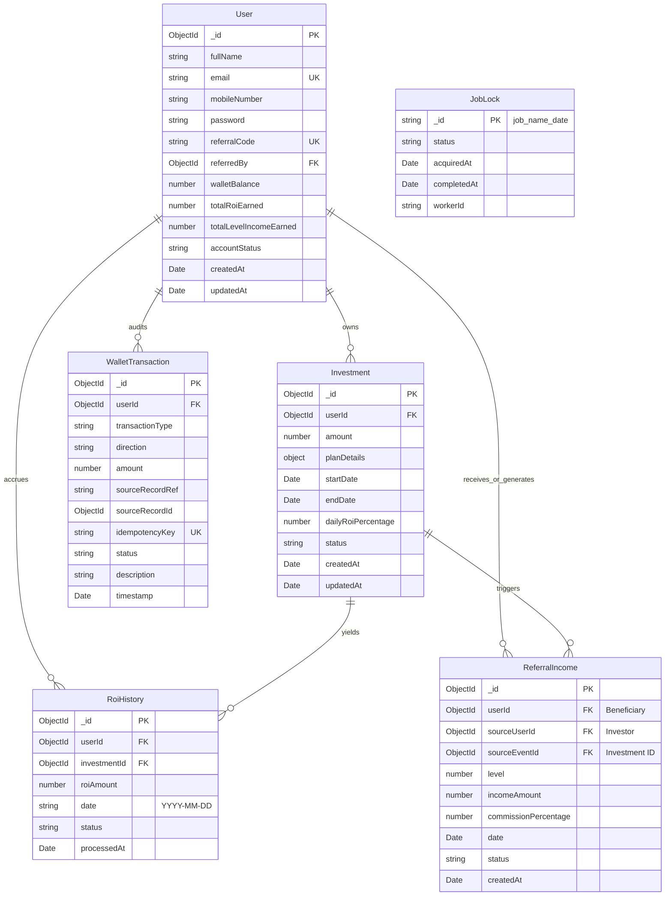

# NexaChain AI — Database Schema Design Specification

## 1. Entity Relationship Diagram

---

## 2. Model Schemas & Specifications

### 2.1 User Model (`models/User.js`)
| Field | Type | Required | Default | Description / Constraints |
|---|---|---|---|---|
| `fullName` | String | Yes | - | User's full name, trimmed, 2-100 chars. |
| `email` | String | Yes | - | Unique, lowercase, indexed, validated email. |
| `mobileNumber` | String | Yes | - | User's contact number with country/area formatting. |
| `password` | String | Yes | - | Hashed with bcrypt (10 rounds). Excluded in JSON representations. |
| `referralCode` | String | Yes | Auto | Unique, uppercase alphanumeric 8-character string (e.g. `NEXA7B2K`). |
| `referredBy` | ObjectId | No | null | Ref `User`. Null for root users. Self-referral prohibited. |
| `walletBalance` | Number | Yes | 0.00 | Current spendable/withdrawable balance. Min: 0. |
| `totalRoiEarned` | Number | Yes | 0.00 | Lifetime accrued daily ROI. Min: 0. |
| `totalLevelIncomeEarned`| Number | Yes | 0.00 | Lifetime accrued referral commission. Min: 0. |
| `accountStatus`| String | Yes | `Active` | Enum: `['Active', 'Inactive', 'Suspended']`. |
| `createdAt` / `updatedAt` | Date | Auto | - | Standard Mongoose timestamps. |

**Indexes**:
- `{ email: 1 }` (Unique)
- `{ referralCode: 1 }` (Unique)
- `{ referredBy: 1 }` (Fast hierarchy lookups)

---

### 2.2 Investment Model (`models/Investment.js`)
| Field | Type | Required | Default | Description / Constraints |
|---|---|---|---|---|
| `userId` | ObjectId | Yes | - | Ref `User`. The investor owning this principal. |
| `amount` | Number | Yes | - | Monetary principal invested. Min: 10.00. |
| `planDetails` | Object | Yes | - | Embedded snapshot of plan: `{ planId, planName, durationDays, minAmount, maxAmount }`. |
| `startDate` | Date | Yes | Now | Date when investment commenced. |
| `endDate` | Date | Yes | - | Calculated date: `startDate + durationDays`. |
| `dailyRoiPercentage` | Number | Yes | - | Immutable daily yield rate (e.g., 1.50 for 1.5%). |
| `status` | String | Yes | `Active` | Enum: `['Active', 'Completed', 'Cancelled']`. |
| `createdAt` / `updatedAt` | Date | Auto | - | Timestamps. |

**Indexes**:
- `{ userId: 1, status: 1 }`
- `{ status: 1, startDate: 1, endDate: 1 }` (Fast cron batch retrieval)

---

### 2.3 ReferralIncome Model (`models/ReferralIncome.js`)
| Field | Type | Required | Default | Description / Constraints |
|---|---|---|---|---|
| `userId` | ObjectId | Yes | - | Ref `User`. Beneficiary receiving the commission. |
| `sourceUserId` | ObjectId | Yes | - | Ref `User`. Investor who created the qualifying event. |
| `sourceEventId`| ObjectId | Yes | - | Ref `Investment`. Investment triggering the commission. |
| `level` | Number | Yes | - | Uplink depth (1 = direct parent, 2 = grandparent, 3 = great-grandparent). |
| `incomeAmount` | Number | Yes | - | Dollar/rupee commission credited. |
| `commissionPercentage` | Number | Yes | - | Rate applied for this level (e.g., 5.0 for Level 1). |
| `date` | Date | Yes | Now | Date of event. |
| `status` | String | Yes | `Credited`| Enum: `['Credited', 'Pending', 'Reversed']`. |

**Indexes & Constraints**:
- Compound Unique Index: `{ sourceEventId: 1, level: 1, userId: 1 }` (Ensures that an investment cannot yield referral income to the same beneficiary at the same level twice).
- Index: `{ userId: 1, date: -1 }` (Fast history queries).

---

### 2.4 RoiHistory Model (`models/RoiHistory.js`)
| Field | Type | Required | Default | Description / Constraints |
|---|---|---|---|---|
| `userId` | ObjectId | Yes | - | Ref `User`. Recipient of ROI. |
| `investmentId` | ObjectId | Yes | - | Ref `Investment`. Source investment generating this ROI. |
| `roiAmount` | Number | Yes | - | Computed daily return ($ amount). |
| `date` | String | Yes | - | Normalized calendar date string (`YYYY-MM-DD`). |
| `status` | String | Yes | `Credited`| Enum: `['Credited', 'Failed', 'Skipped']`. |
| `processedAt` | Date | Yes | Now | Timestamp of execution. |

**Indexes & Constraints**:
- **Critical Compound Unique Index**: `{ investmentId: 1, date: 1 }` (Guarantees zero duplicate payouts for the same investment on any single calendar date).
- Index: `{ userId: 1, date: -1 }` (Paginated user view).

---

### 2.5 WalletTransaction Model (`models/WalletTransaction.js`)
| Field | Type | Required | Default | Description / Constraints |
|---|---|---|---|---|
| `userId` | ObjectId | Yes | - | Ref `User`. Account whose balance was affected. |
| `transactionType` | String | Yes | - | Enum: `['ROI_CREDIT', 'REFERRAL_CREDIT', 'INVESTMENT_DEBIT', 'WALLET_DEPOSIT', 'ADMIN_ADJUSTMENT']`. |
| `direction` | String | Yes | - | Enum: `['CREDIT', 'DEBIT']`. |
| `amount` | Number | Yes | - | Absolute monetary amount (always positive, > 0). |
| `sourceRecordRef` | String | No | - | Model name: `'RoiHistory'`, `'ReferralIncome'`, `'Investment'`. |
| `sourceRecordId` | ObjectId | No | - | ID of triggering document. |
| `idempotencyKey` | String | Yes | - | Unique system key preventing duplicate ledger lines. |
| `status` | String | Yes | `SUCCESS` | Enum: `['SUCCESS', 'PENDING', 'FAILED', 'REVERSED']`. |
| `description` | String | Yes | - | Human-readable audit narrative. |
| `balanceAfter` | Number | No | - | Running balance checkpoint after transaction. |
| `timestamp` | Date | Yes | Now | Timestamp. |

**Indexes**:
- Unique Index: `{ idempotencyKey: 1 }`
- Index: `{ userId: 1, timestamp: -1 }`

---

### 2.6 JobLock Model (`models/JobLock.js`)
| Field | Type | Required | Description |
|---|---|---|---|
| `_id` | String | Yes | Lock identifier (e.g. `daily_roi_2026-10-31`). |
| `status` | String | Yes | Enum: `['PROCESSING', 'COMPLETED', 'FAILED']`. |
| `workerId` | String | Yes | Identifier of the node process holding the lock. |
| `acquiredAt` | Date | Yes | Timestamp lock was obtained. |
| `completedAt` | Date | No | Timestamp lock was released. |
| `details` | Object | No | Summary statistics (processed count, total distributed). |
